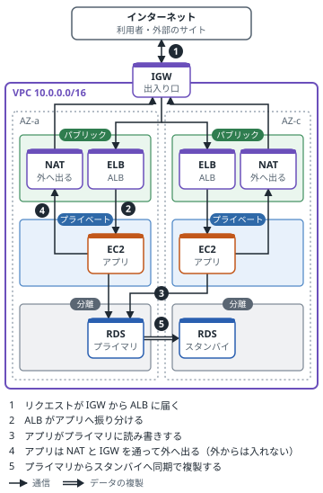

# 図解・操作型教材の設計書

`learning-design.md` の要件 V（見てわかる）と N（動画と実機なしで入力が完結する）を満たすための、新しい教材の形式を決める文書です。図、段階表示、実物を読む、その場の確認、ミニラボ、設計パターン、シミュレーターを扱います。

この文書は設計です。構成図（2章、4.2、5章）だけは、試作（13章の W1・W2。2026-11-20）で作り、記法と上限の数値を確かめました。そのほかは、まだ実装していません。実装が済んだ形式は `content-guide.md` と `app-spec.md` に移します（13章の W18）。

## 1. 目的と範囲

### 1.1 この文書が決めること

- 図の記法（何をどの形と色で描くか）と、図のデータ形式
- 図・実物・その場の確認を、既存のレッスンに差し込む方法（本文は保つ。【決定 L-2】）
- ミニラボ、設計パターン、シミュレーターの形式と、作るものの一覧
- 検証、網羅の測り方、アプリ側の表示、実装タスク

### 1.2 共通の規則

1. **新しい事実を持ち込まない**: 図に描く内容、実物の注目点、ミニラボの手順、シナリオの結果は、差し込み先のレッスンの本文（`lessonRefs`）か、図鑑の verified の事実（`factRefs`）で裏づけます。どちらかが 1 つ以上なければ validate のエラーです。裏づけのない内容が要るときは、先に図鑑の事実を足します。
2. **数値と料金**: 数値は図鑑の事実を指します。料金の金額は書きません（図鑑と同じ）。料金の高低は「高い・中くらい・安い」などの段階で示します。
3. **最新性**: `content-guide.md` 6章・6.1 の規則がそのまま当たります（提供終了のサービスを正解の構成に使わない、既定値に依存しない、新旧の名前）。
4. **コンソールの画面は扱わない**: 設定は「項目と値」で示します（【L-6】）。
5. **なくても読める**: 図や実物が表示されなくても、レッスンの本文だけで意味が通るようにします。検証状態が `needs-fix`・`rejected` の図は表示されないためです。

## 2. 図の記法

### 2.1 考え方

- 図は宣言的なデータで書き、アプリが SVG で描きます（【L-5】）。書く人は、入れ子と並び順だけを書き、座標は書きません。
- 同じものは、どの図でも同じ形と色です。学習者が記法を覚えるのは 1 回で済みます。
- 色だけで区別しません。入れ物には種類の語（「パブリック」など）を、部品には短い名前を必ず添えます。
- AWS の公式アイコンは使いません。分類ごとの単純な記号と短い名前（例「EC2」「S3」）で描きます。

### 2.2 入れ物（`box`）

入れ物は、中に部品やほかの入れ物を持つ枠です。

| 種類 | 表すもの | 描き方 |
|---|---|---|
| `aws` | AWS のクラウド全体 | 細い実線の枠 |
| `org`、`ou`、`account` | 組織、OU、アカウント | 実線の枠。ラベルの前に種類の語 |
| `region` | リージョン | 破線の角丸 |
| `vpc` | VPC | 太めの実線 |
| `az` | アベイラビリティーゾーン | 点線 |
| `subnet-public`、`subnet-private`、`subnet-isolated` | サブネット（ルートで決まる 3 種類） | 薄い塗り。3 種類で色相を変え、ラベルに「パブリック」「プライベート」「分離」を入れる |
| `asg` | Auto Scaling グループ | 破線。角に増減の記号 |
| `sg` | セキュリティグループ | 細い破線。ラベルに「SG」 |
| `edge` | エッジロケーション | 破線の角丸 |
| `onprem` | オンプレミス（データセンター、事業所） | 灰色の実線 |
| `group` | 上にない、まとまり | 細い実線。ラベルは必須 |

種類の語は、描画が補います。サブネットと `sg` は、ラベルに種類の語（「パブリック」「プライベート」「分離」「SG」）がなければ前に付けます。`org`・`ou`・`account` は、ラベルの前に種類の語を付けます。そのほかの入れ物は、ラベルを省くと種類の名前（「リージョン」「AZ」など）を出します。

### 2.3 部品（`node`）

- **サービス**: 台帳（`services.json`）の `id` を書きます（例 `ec2`、`s3`、`rds`、`elb`、`nat-gateway`）。分類の色と短い名前は台帳から決まります。
- **部品は 2 行で描きます**。1 行目は短い名前、2 行目は `label`（役割や種類。例 `elb` に「ALB」、`rds` に「プライマリ」、`ebs` に「gp3」）です。サービスの短い名前は、台帳の `short`、なければ正規名から「Amazon」「AWS」を除いたものです。それでも長いものは `scripts/lib/diagram.mjs` の表で短くします（例「NAT」「TGW」「Secrets Mgr」）。
- **サービスでない部品**: 次の語彙を使います。台帳にあるものは台帳の `id` を優先します（試作で台帳と突き合わせ済み。台帳の `id` と重なる語彙はありません）。

| 語彙 | 表すもの |
|---|---|
| `actor`、`client` | 人、端末やアプリ |
| `internet` | インターネット |
| `server`、`datastore` | オンプレミスや外部のサーバー、データの置き場所 |
| `igw`、`vgw`、`cgw` | インターネットゲートウェイ、仮想プライベートゲートウェイ、カスタマーゲートウェイ |
| `route-table`、`nacl`、`eni` | ルートテーブル、ネットワーク ACL、ネットワークインターフェイス |
| `endpoint-gateway`、`endpoint-interface`、`peering` | VPC エンドポイント（2 種類）、VPC ピアリング接続 |
| `policy`、`key`、`data` | ポリシー、鍵、データ（オブジェクト、メッセージ、レコード） |
| `generic` | 上にないもの。ラベルは必須 |

- **分類の色**: 台帳の分類ごとに色相を 1 つ割り当てます（コンピューティング、コンテナ、ストレージ、データベース、ネットワーク、セキュリティ、アプリケーション統合、分析、管理、移行、そのほか）。色の値は `app/src/styles.css` の `--dg-cat-*`（分類）と `--dg-*`（線、入れ物、札）にあり、明るい背景用と暗い背景用の 2 組です。試作で、文字は 4.5:1 以上、形は 3:1 以上のコントラストを両方の背景で確かめました。注目していない要素は薄くします（不透明度 0.35）。薄い要素の内容は、段階の説明と代替文で伝えます。

### 2.4 線（`edges`）

| `kind` | 表すもの | 描き方 |
|---|---|---|
| `request`（既定） | リクエスト、通信 | 実線の矢印 |
| `data` | データの複製、転送、バックアップ | 二重線の矢印 |
| `control` | 設定、管理、監視、通知 | 点線の矢印 |
| `blocked` | 届かない通信 | 実線の先に × |

- `both: true` で両方向の矢印にします。
- `label` は 16 字までですが、線の区間に収まる長さにします（隣り合う部品の間なら全角 2〜4 字が目安。例「同期」「発行」「HTTPS」）。長い説明は、線ではなく段階の説明（5章）に書きます。収まらないラベルは validate が警告します。
- 段階表示の図では、線に段階の番号が付きます。

### 2.5 上限

幅 360px の画面で読めることを条件に、次の上限を置きます（2026-11-20 の試作で確かめた値。4.7）。超える図は、分けるか、行を列に替えます。

| 項目 | 上限 | 超えたとき |
|---|---|---|
| 図の幅 | 328（設計の単位。幅 360px の画面から左右の余白を引いた幅） | エラー |
| 図の高さ | 440（図と段階の説明が 1 画面に入る高さ） | 警告 |
| 部品の数 | 14 | エラー |
| 入れ子の深さ | 5 | エラー |
| 線の数 | 16 | エラー |
| 段階の数 | 8 | エラー |
| ラベルの長さ | 部品 12 字、入れ物 20 字、線 16 字 | エラー |
| 文字の大きさ | 部品の名前 11px、そのほか 10px（設計の単位で） | 描画が守る |
| 表示の倍率 | 1.25 倍まで（広い画面で小さな図が大きくなりすぎないように）。画面いっぱいに広げた表示（12.2）は 2 倍まで | 描画が守る |

構成図以外の 4 種類の数と字数の上限は 4.3〜4.6 にあります（正本は `scripts/lib/schema.mjs`。書く人向けの一覧は `content-guide.md` 16 章）。4 種類の図も、描く形（文字は上の見積もり）の外接矩形が幅 328 に収まるかを検査します。

- 幅は、レイアウトした結果で検査します（文字の幅は、全角を 1 字、そのほかを 0.6 字として見積もります）。「横に並べられる部品の数」は置きません。幅の検査が代わりになります（部品だけなら横に 4 つ前後、3 階層の入れ子の中なら 2 つまでが入ります）。
- 幅 360px より狭い画面では、入る幅まで縮めて描きます（横にはスクロールしません）。
- 線のラベル、状態の札、段階の番号が、置ける場所に収まらないときは警告（`diagram-crowded`）です。ラベルを短くするか、並べ方を変えます。
- 線や矢じりが入れ物のラベルを横切るのを、レイアウトが避けられないときは警告（`diagram-overlap`）です。入れ物のラベルを短くするか、並べ方を変えます（4.2.1）。

## 3. 図の種類

| `type` | 名前 | 見せるもの | 例 |
|---|---|---|---|
| `architecture` | 構成図 | 部品の置き場所とつながり。段階表示で、通信の経路、処理の順序、障害時の切り替わり、構成の育ち方 | 3 層の VPC、ファンアウト、フェイルオーバー |
| `decision` | 選択フロー | 質問に答えて候補を絞る道筋 | ストレージの選び方、ポリシーの評価の流れ |
| `position` | 位置づけ図 | 2 つ（または 1 つ）の軸の上での候補の位置 | S3 のクラス（取り出しの速さ × 保管の料金）、DR の 4 戦略 |
| `timeline` | 時間の図 | 時間に沿った状態の移り変わり | ライフサイクル、バックアップの保持、可視性タイムアウト |
| `layers` | 層の図 | 層ごとの担当や、重なる防御 | 責任共有モデル、管理する範囲の比較、防御の層 |

表で足りる比較は、今までどおり Markdown の表で書きます。

## 4. 図のデータ形式

### 4.1 置き場所と共通の項目

- 1 枚 1 ファイル。`content/saa-c03/diagrams/<id>.json`。ID は `dg-<英小文字とハイフン>`（例 `dg-vpc-three-tier`）。
- 形式は JSON です（図鑑のエントリと同じ。構造を機械で厳しく検査するため）。

| 項目 | 内容 |
|---|---|
| `id`、`type` | ID と、3章の種類 |
| `title` | 図の題（4〜60 字） |
| `alt` | 代替文（40〜600 字）。図を見なくても同じ内容がわかるように、置き場所とつながりを文章で書く |
| `lessonRefs`、`factRefs` | 裏づけ（1.2 の 1）。合わせて 1 つ以上 |
| `createdBy` | 作成者 ID |

### 4.2 構成図（`architecture`）

```json
{
  "id": "dg-vpc-three-tier",
  "type": "architecture",
  "title": "3 層の VPC（2 つの AZ）",
  "alt": "VPC の中に 2 つの AZ があり、それぞれにパブリック、プライベート、分離の 3 つのサブネットがあります。（以下略）",
  "lessonRefs": ["lesson-3.4-vpc-design"],
  "factRefs": [],
  "createdBy": "v1",
  "root": {
    "dir": "col",
    "children": [
      { "id": "user", "node": "actor", "label": "利用者" },
      { "id": "igw", "node": "igw", "label": "出入り口" },
      {
        "id": "vpc", "box": "vpc", "label": "VPC 10.0.0.0/16", "dir": "row",
        "children": [
          {
            "id": "az-a", "box": "az", "label": "AZ-a", "dir": "col",
            "children": [
              { "id": "pub-a", "box": "subnet-public", "label": "パブリック", "dir": "row",
                "children": [
                  { "id": "alb-a", "node": "elb", "label": "ALB" },
                  { "id": "nat-a", "node": "nat-gateway", "label": "外へ出る" }
                ] },
              { "id": "pri-a", "box": "subnet-private", "label": "プライベート",
                "children": [{ "id": "app-a", "node": "ec2", "label": "アプリ" }] },
              { "id": "iso-a", "box": "subnet-isolated", "label": "分離",
                "children": [{ "id": "db-a", "node": "rds", "label": "プライマリ" }] }
            ]
          }
        ]
      }
    ]
  },
  "edges": [
    { "id": "e1", "from": "user", "to": "igw", "label": "HTTPS" },
    { "id": "e2", "from": "igw", "to": "alb-a" },
    { "id": "e3", "from": "alb-a", "to": "app-a" },
    { "id": "e4", "from": "app-a", "to": "db-a" },
    { "id": "e5", "from": "app-a", "to": "nat-a" }
  ],
  "steps": [
    { "text": "利用者のリクエストは、インターネットゲートウェイから VPC に入り、パブリックサブネットの ALB に届きます。",
      "focus": ["user", "igw", "alb-a"], "edges": ["e1", "e2"] },
    { "text": "ALB は、プライベートサブネットのアプリケーションサーバーへ振り分けます。",
      "focus": ["alb-a", "app-a"], "edges": ["e3"] }
  ]
}
```

（例は AZ を 1 つだけ書いて短くしています。描いたときの見本は 4.7 にあります。）

- `root` は入れ物と部品の木です。入れ物は `box`、部品は `node` を持ちます。`dir` は子の並べ方（`row` 横、`col` 縦。省くと `col`）です。
- `box` も `node` も持たず `children` だけを持つ要素は、**見えない並べ枠**です。枠もラベルも描かず、子の並べ方だけを決めます（例: 縦に並ぶ図の中で、2 つのリージョンだけを横に並べる）。`id` は付けられますが、線の端、`focus`・`reveal`・`marks` には使えません。
- `align`（`start`・`center`・`end`。省くと `center`）は、並べる向きと直交する向きでの子の寄せ方です（例: 左右の AZ で、部品を内側に寄せて線を短くする）。
- `edges` の `from`・`to` は、部品か入れ物の `id` です。入れ物と、その中の部品は結べません。
- `fromSide`・`toSide`（`top`・`bottom`・`left`・`right`）で、線が出る辺と着く辺を指定できます。ふつうは書きません（4.2.1 の規則で決まります）。回り込む線を、ほかの線と分けたいときだけ使います。
- `steps` は段階表示です（5章）。省くと動かない図になります。

#### 4.2.1 レイアウトの規則

書く人は座標を書きません。次の規則で、同じデータからいつも同じ図ができます（`scripts/lib/diagram-layout.mjs`。validate とアプリのビルドが同じものを使います）。

- **大きさ**: 部品は幅 56〜104（名前とラベルの長さで決まる）、高さ 42。入れ物は、内側の余白 6 と、ラベルの帯 15 を持ちます。
- **間隔**: 線で直接つながる隣どうしは 20、つながらない隣どうしは 6。同じすき間を通る線が増えると、1 本につき 5 ずつ広げます（40 まで）。ラベルつきの線が横に結ぶ隣どうしは、ラベルが入る幅まで広げます。その線が入れ物の枠をまたぐとき（隣どうしの入れ物の中の部品を結ぶとき）は、枠で区切られた区間のどれかに「ラベルの幅 + 14」が入るように、隣どうしの入れ物の間を広げます。広げると幅 328 を超えるときは、328 まで広げ、ラベルの背面の矩形の両側に 1 ずつ空けば許します。
- **そろえ**: 同じ入れ物の中に並ぶサブネットは、並べる向きと直交する向きの大きさをそろえます（左右の AZ で、サブネットの段が同じ高さに並びます）。
- **線**: 縦と横の線分だけで結びます（まっすぐ、Z 字、L 字）。出る辺と着く辺は、2 つの部品が縦にも横にも離れているとき、2 つを両方含むいちばん内側の入れ物の並べ方（`dir`）に従います。同じ辺から出る線は、辺の上で等間隔に分けます。入れ物のラベルを線が横切り、ラベルの置き場所（下の「入れ物のラベル」）がないときは、線を付け替えます。試すのは、上か下の辺で、その辺に線が 1 本だけのポートを辺の両端寄り（端から 9）にずらすことと、Z 字の線の片方の辺を左か右の辺に替えて L 字にすること（上か下に残る側のポートを両端寄りにずらす案も）です。ラベルを置けない入れ物が減り、「部品の上を通る線と入れ物の枠に沿って走る線の数」と「線どうしの交差の数」が、どちらも増えないものだけを採ります。まっすぐな線は付け替えません。`fromSide`・`toSide` を書いた線は、辺は替えません（ポートの位置はずらすことがあります）。
- **入れ物のラベル**: 左上が既定です。線か矢じりがラベルを横切るか、ラベルから 3 より近くを通るときは、ラベルの帯の中で、その線の右へずらします（入れ物の右の端まで）。入れ物の札とも重ねません。
- **浮く要素**（線のラベル、状態の札、段階の番号）: 入れ物のラベル → 線のラベル → 状態の札 → 段階の番号の順に、決まった候補の位置を試し、部品や先に置いたものと重ならない最初の位置に置きます。矢じりとも重ねません。線のラベルは、長い区間の中央の脇を先に、次に、区間を入れ物の枠で区切った区間の中央を試し、入れ物の枠をまたがない位置を、ほかの線を避ける位置より優先します。入れ物の札は右上です（札の出る入れ物は、ラベルと札が並ぶ幅を確保し、間を 10 空けます）。部品の札は、角をまたぐ位置（右上 → 右下 → 左上 → 左下）、次に角の外寄りの位置を試し、ほかの部品とラベルに加えて、その部品自身の文字（2 行目のラベルを含む）とも重ならない位置にします。段階の番号は、その段階の最初の線の上です（前の段階の番号がすでにある線は避けます）。短い線で矢じりの間に置けないときは、線の中央の横に、矢じりから離して置きます。番号は入れ物の枠にも乗せません（線を入れ物の枠で区切った区間の中央も試します。線のない段階で入れ物の角に置くときは、角の内側の次に、枠の外側を試します）。
- **重ね順**: 入れ物 → 線 → 入れ物のラベル → 部品 → 線のラベル → 札 → 番号。ラベルには背景色の縁を付け、線がラベルの後ろを通るように見せます。停止の × は部品の文字の後ろに描き、停止した部品の文字には部品の地の色の縁を付けます（× が文字に重ならない）。線のラベルを薄くするときは文字だけを薄くし、背面の矩形は塗ったままにします（後ろの線や枠を透かさない）。
- **できあがりの検査**: レイアウトの最後に、scene で重なりを確かめ、警告にします（`sceneCollisions`）。線か矢じりが入れ物のラベルを横切るか 2 より近くを通る、線が入れ物の枠に沿って走るのは `diagram-overlap`、札が部品の文字やほかのラベルに重なる、線のラベルを入れ物の枠が横切る、線のラベルか番号が矢じりに重なる、番号が部品やラベルに重なる、番号が入れ物の枠に乗るのは `diagram-crowded` です。札と番号は、段階ごとに、実際に同時に見えるものどうしだけを調べます（札は段階 1 以降のその段階の印だけ、番号は全体の段階では全部、段階 k では k だけ。まだ現れていない要素は除く）。線と札の交わりは調べません（線が札の下を通るのは、描いた図で目で確かめます）。1 つの浮く要素について `diagram-crowded` がいくつも出るときは、最初の 1 件だけを出します。
- **段階で動かさない**: 位置はすべての段階で同じです。段階で変わるのは、濃淡、強調、札、まだ現れていない要素を隠すことだけです。このため、入れ物のラベルは、あとの段階で現れる線も避けて置きます。早い段階では、ラベルが帯の中ほどに見え、左右の入れ物でラベルの位置がそろわないことがあります。

### 4.3 選択フロー（`decision`）

```json
{
  "type": "decision",
  "start": "q1",
  "nodes": [
    { "id": "q1", "ask": "複数のサーバーから同時に読み書きしますか？",
      "choices": [{ "label": "はい", "to": "q2" }, { "label": "いいえ", "to": "r-ebs" }] },
    { "id": "r-ebs", "result": "Amazon EBS", "service": "ebs",
      "why": "1 つのインスタンスにつなぐブロックストレージで足ります。", "factRefs": [] }
  ]
}
```

- 質問（`ask` と `choices`）と結論（`result` と `why`）の木です。上限は、質問 7 つ、深さ 4、結論 8 つ。
- アプリは、木の全体を見せる表示と、質問に答えて進む表示（たどる）を持ちます。
- 質問の文は、問題文の制約語と同じ言葉で書きます（例「運用の負荷を最小にしたいですか？」）。
- 字数は、質問 4〜60 字、選択肢 10 字、結論 24 字、理由 10〜150 字です。
- 全体の表示は縦に流す前提なので、高さの警告（2.5 の 440）の対象外です（たどる表示が主。2026-11-23 の実装で決めた）。
- たどった先では「結論: …」と出し、結論のサービス名が結論の文と違うときだけ「サービス: …」を添えます。

### 4.4 位置づけ図（`position`）

```json
{
  "type": "position",
  "x": { "label": "取り出しの待ち時間", "low": "長い", "high": "すぐ" },
  "y": { "label": "保管の料金", "low": "安い", "high": "高い" },
  "items": [
    { "id": "std", "label": "S3 Standard", "service": "s3", "x": 5, "y": 5, "note": "頻繁に読むデータ" }
  ]
}
```

- `x`・`y` は 1〜5 の順位で、数値の比ではありません（図の下に「位置は順位で、比率ではありません」と出します）。`y` を省くと 1 本の軸に並べます。
- 項目は 10 個まで。順位の裏づけは `factRefs` で指します。
- 字数は、軸の名前 14 字、軸の端 4 字、項目の名前 30 字（2026-11-23 に 24 字から広げた。「S3 Glacier Flexible Retrieval」が入るように）、注記 40 字です。
- 丸の左右に名前が収まらない項目は、図には番号だけを描き、名前は図の下（と広げた表示）の番号つきの凡例で読ませます。警告は出しません。

### 4.5 時間の図（`timeline`）

```json
{
  "type": "timeline",
  "ticks": [{ "at": 0, "label": "作成" }, { "at": 30, "label": "30 日" }, { "at": 90, "label": "90 日" }, { "at": 365, "label": "1 年" }],
  "lanes": [
    { "label": "オブジェクト",
      "spans": [{ "from": 0, "to": 30, "label": "S3 Standard" }, { "from": 30, "to": 90, "label": "S3 Standard-IA" }],
      "marks": [{ "at": 365, "label": "削除" }] }
  ]
}
```

- 目盛り（`ticks`）は等間隔に並べます（時間の比では並べません。短い区間がつぶれないようにするため）。`spans` と `marks` は目盛りの値を指します。
- 目盛りは 8 つまで、帯（`lanes`）は 4 本までです。
- 字数は、目盛り 6 字、帯の名前 10 字、区間のラベル 30 字（折り返す。2026-11-23 に 24 字から広げた）、札 6 字です。札が帯の幅に収まらないときは警告（`diagram-crowded`）です。

### 4.6 層の図（`layers`）

```json
{
  "type": "layers",
  "columns": ["Amazon EC2", "AWS Fargate", "AWS Lambda"],
  "rows": [
    { "label": "アプリケーションのコード", "cells": ["you", "you", "you"] },
    { "label": "OS とランタイム", "cells": ["you", "aws", "aws"] }
  ],
  "legend": { "you": "利用者が管理", "aws": "AWS が管理" }
}
```

- 上から下へ層を並べ、列ごとに担当を塗り分けます。列を省くと 1 列です。凡例の種類は 3 つまで。
- 字数は、列 14 字、行 16 字、凡例 8 字です。行は 8 つ、列は 4 つまでです。
- 行には、短い注記（`note`。30 字まで、1 行）を書けます。行のすぐ下に「※」を付けて描きます（1 行に収まらないときはエラー）。塗り分けだけでは伝わらない留保（「ただし、…」）に使います。注記も図の中の文字なので、同じ内容を代替文にも書きます（`alt` は、図を見なくても同じ内容がわかるように書く）。

### 4.7 見本

`docs/assets/diagram-sample-vpc.svg` は、4.2 の例を 2 つの AZ に広げ、幅 360px で手で描いた見本です。記法（2章）の見た目の基準にします。実装の描画は、この見本と同じ情報が同じ幅で読めることを目標にします。



試作（W1・W2。2026-11-20）では、次の 3 枚をデータから描き、幅 360px の画面と、明るい背景・暗い背景で読めることを確かめました。データは `content/saa-c03/diagrams/` にあります。作った時点では検証前（`createdBy: "v1"`）でした。今はどれも検証済みで、レッスンの本文から参照しています（3 層の VPC はレッスン 3.4 と 2.2 の高可用性、ファンアウトはレッスン 2.1、パイロットライトはレッスン 2.2 の DR）。

| ID | 確かめたこと | 部品 / 入れ物 / 線 / 段階 | 幅 × 高さ |
|---|---|---|---|
| `dg-vpc-three-tier` | 3 階層の入れ物（VPC → AZ → サブネット）、左右の対称、回り込む線（`fromSide`・`toSide`）、内側への寄せ（`align`） | 10 / 9 / 12 / 5 | 328 × 419 |
| `dg-sns-sqs-fanout` | 横に流れる図、1 つから 3 つへの分岐、見えない並べ枠、`marks`（停止） | 8 / 3 / 7 / 4 | 320 × 205 |
| `dg-dr-pilot-light` | 状態の移り変わり（`marks` の待機・停止・昇格・新規）、あとから現れる線（`reveal`） | 6 / 2 / 6 / 5 | 292 × 258 |

幅と高さは、2026-11-23 に重なりを直したあとのレイアウトの値です（パイロットライトは、線のラベルが入れ物の枠をまたがないように、2 つのリージョンの間を広げた）。3 層の VPC が、幅の上限（328）に届く大きさです。これより部品の多い構成は、1 枚に詰めずに分けます（例: ネットワークの図と、データベースの切り替えの図）。

W1・W3（2026-11-23）では、ほかの 4 種類の見本を 1 枚ずつ作りました。どれも既存のレッスンの記述と図鑑の検証済みの事実から作り、作った時点では検証前（`createdBy: "v2"`）でした。今はどれも検証済みで、裏づけのレッスン（選択フローはレッスン 3.1、位置づけ図と時間の図はレッスン 4.1、層の図は基礎講座の責任共有モデル）の本文から参照しています。

| ID | 種類 | 裏づけ |
|---|---|---|
| `dg-storage-choice` | 選択フロー（ブロック・ファイル・オブジェクトのストレージの選び方） | レッスン 3.1、基礎講座のストレージの種類、結論ごとの `factRefs` |
| `dg-s3-glacier-position` | 位置づけ図（S3 Glacier の 3 クラスの取り出しの速さと最低保存期間） | レッスン 4.1、図鑑の S3・S3 Glacier の事実 |
| `dg-s3-lifecycle-timeline` | 時間の図（ライフサイクルの移行と有効期限の例） | レッスン 4.1 の表、`s3.lifecycle` |
| `dg-compute-responsibility-layers` | 層の図（EC2・RDS・抽象化型の責任の分担） | 基礎講座の責任共有モデルの表 |

W8（2026-11-23）では、ミニラボの見本のために、構成が育つ構成図を 1 枚足しました。`dg-vpc-build-up` は、`dg-vpc-three-tier` と同じ部品と並びで、段階の `reveal` を使い、VPC → サブネット → インターネットゲートウェイ → ALB → アプリケーションサーバー → NAT ゲートウェイ → データベースの順に部品を足して見せます（段階 7）。裏づけはレッスン 3.4・1.2・2.2 と図鑑の VPC の事実です。作った時点では検証前（`createdBy: "v3"`）でした。今は検証済みで、レッスン 1.2 の本文から、NAT ゲートウェイの段階（`?step=6`）で止めて参照しています。

### 4.8 Markdown からの参照

レッスン、早見表、ミニラボ、設計パターンの本文に、1 行で書きます。本文のほかの行は変えません。

```markdown


```

- 角括弧の中は、図の下に出す短い説明（キャプション）です。
- `?step=<番号>` を付けると、その段階の状態で止めた図を出します（ミニラボの手順で使います）。
- 存在しない ID は validate のエラーです（図鑑へのリンクと同じ）。
- タイトルつき（``）も同じ扱いです。参照形式（`![説明][ref]` と `[ref]: #/diagrams/<id>`）は validate のエラーにします（表示と検査の判定をそろえるため）。コードフェンスとインラインコードの中の参照は数えません。
- validate の検査は行単位の近似なので、アプリのビルドが本文ごとに、remark で解析した表示の判定（図として扱う参照、確認として変換する引用）と突き合わせ、ずれがあれば文書名と行を出して止めます（その場の確認も同じ。7 章）。
- 文の途中に書いた図の画像は、図へのリンクにします。図が読み込めないときは、図だけを省いて本文を残します。
- 検証済みでない図には、本文の中でも「未検証」の札を出します（未検証の図が出るのは開発用のビルドだけ。11.1）。本文が検証済みでない図（未検証・`needs-fix`・`rejected`）を指すと、validate の警告にします（W6 で決めた。止めはしない）。

## 5. 段階表示

構成図の `steps` で、流れを 1 段ずつ見せます。

| 項目 | 内容 |
|---|---|
| `text` | その段階の説明（20〜200 字）。図の下に出す |
| `focus` | 目立たせる部品と入れ物の `id`。ほかは薄くする |
| `edges` | その段階で通る線の `id` |
| `reveal` | その段階で初めて現れる部品・入れ物・線の `id`（ミニラボで構成を育てるとき、切り替え後の経路を見せるとき）。その段階より前では隠す。どの段階の `reveal` にもないものは、最初から見える |
| `marks` | 状態の札。`{ "id": "db-a", "state": "down" }`。`state` は `down`（停止）、`standby`（待機。用意してあるが動かしていない）、`off`（切り離し）、`new`（新規）、`promoted`（昇格）。札には文字を出し、色だけで伝えない |

- **段階 0 は全体の表示**です。すべての要素（`reveal` のものも含む）と、すべての段階の番号を出し、札は出しません。段階 1 からが `steps` の各段です。
- `marks` は、書いた段階にだけ出ます。次の段階へは持ち越しません（止まったままなら、次の段階にも書きます）。停止した部品は、赤い破線の枠と × と札「停止」で、停止した入れ物は、赤い破線の枠と札で示します。待機と切り離しは点線の枠、新規と昇格は太い枠です。
- `reveal` の順は validate が確かめます。入れ物より先にその中身を現すこと、端の部品より先に線を現すこと、まだ隠れている要素を `focus`・`edges`・`marks` で指すことは、エラーです。
- 操作は「前へ」「次へ」と、今の段階の数字（`2 / 5`）です。自動では進めません。キーボードの左右でも動かせます。段階が変わると、「段階 2 / 全 5。」に続けて説明を読み上げます。
- Markdown から `?step=<番号>` で止めた図（4.8）は、操作を出さず、その段階の説明だけを添えます。
- 「すべての段階を文章で読む」を開くと、段階の説明が番号つきの一覧で読めます（スクリーンリーダーと印刷のため）。
- 動きは、線の強調と部品の濃淡の切り替えだけにします。`prefers-reduced-motion` のときは、切り替えの動きを消します。

## 6. 実物を読む

### 6.1 役割

コンソールで設定する代わりに、設定そのもの（ポリシー、ルートテーブル、ルールの一覧）を、注目点つきで読みます。試験の選択肢は「どの設定を、どう変えるか」を文章で書くので、文章から設定の形を思い浮かべられるようにするのが目的です。

### 6.2 形式

1 つ 1 ファイル。`content/saa-c03/artifacts/<id>.json`。ID は `ar-<英小文字とハイフン>`。

```json
{
  "id": "ar-bucket-policy-org-only",
  "kind": "bucket-policy",
  "title": "組織の中のアカウントだけに読み取りを許すバケットポリシー",
  "format": "json",
  "document": {
    "Version": "2012-10-17",
    "Statement": [{
      "Effect": "Allow",
      "Principal": "*",
      "Action": "s3:GetObject",
      "Resource": "arn:aws:s3:::example-bucket/*",
      "Condition": { "StringEquals": { "aws:PrincipalOrgID": "o-exampleorgid" } }
    }]
  },
  "notes": [
    { "path": "Statement[0].Principal", "text": "Principal は、このバケットにアクセスできる相手を書く欄です。ここでは相手を個別に挙げず、下の Condition で絞っています。" },
    { "path": "Statement[0].Condition", "text": "呼び出し元が、この組織に属するアカウントのときだけ許可します。アカウントが増減しても、ポリシーを直さずに済みます。" }
  ],
  "ask": { "text": "組織に属さないアカウントのロールは、このバケットのオブジェクトを読めますか？",
           "answer": "読めません。条件に合わないので、この文では許可されません。" },
  "lessonRefs": [],
  "factRefs": ["iam.global-key-principalorgid"],
  "createdBy": "v1"
}
```

- `format` は 3 つです。
  - `json`: `document` に設定の本体を JSON で書きます。注目点は `path`（`Statement[0].Condition` のような場所）で指します。アプリが整形して、指した部分を強調します。
  - `table`: `columns` と `rows` で表を書きます（ルートテーブル、セキュリティグループのルールなど）。注目点は `row`（行の番号）で指します。
  - `text`: `lines` に行の配列で書きます（JSON でない設定）。注目点は `lines`（行の番号）で指します。
- `notes` は 2〜5 個。1 個は 120 字までです。
- `ask` は任意です。読んだあとに、設定の結果を 1 つ問います。
- 例に使う名前は、実在しないもの（`example-bucket`、`111122223333` など、公式ドキュメントの例と同じ流儀）にします。
- Markdown からは `` で参照します。

W5（2026-11-23）で決めた細部です。

- **注目点の数**: `notes` は 5 個まで（超えるとエラー）。1 個以下は警告です（上の「2〜5 個」は目安で、11.3 の警告に合わせて読みます）。
- **注目点の場所**: `json` は `path`（キーを `.` でつなぎ、配列は `[番号]`。番号は `0` か、0 で始まらない数字。`Statement[0].Condition.StringEquals.aws:PrincipalOrgID` のようにコロンを含むキーも書けます）。`.` や `[` `]` を含むキーは指せません（今の見本には要りません。要るときは、`["a.b"]` のように引用符で囲む書き方を足します）。`table` は `row`（1 から数える行の番号 1 つ）、`text` は `lines`（1 から数える行の番号の配列。10 個まで）。`format` と違う種類の場所を書くとエラーです。
- **上限**（幅 360px で読めることを条件に決めました。正本は `scripts/lib/schema.mjs` の `ARTIFACT_LIMITS`）: `title` 4〜60 字（図と同じ）、注目点の文 10〜120 字、`ask` の問い 10〜120 字・答え 10〜200 字。表は列 2〜4（列名 16 字まで）・行 1〜12・セル 40 字まで。`text` は 1〜30 行・1 行 80 字まで・字下げ 12 字まで（タブは書けない）。`document` は整形して 40 行まで・入れ子 6 段まで・整形した 1 行は字下げを含めて 120 字まで（KMS キーの ARN を値に持つ行が、キーと字下げを含めて 100 字ほどになるため、`text` より長くした）。`document` に数字だけのキーは書けません（読み込むと並びが変わるため）。
- **表示**: 長い行は折り返し、折り返した行も字下げをそろえます（横にスクロールしない）。表は、幅 520px 以下では行ごとに「列名: 値」を縦に並べます。指した部分は、背景・左の線・番号の 3 つで示し、注目点の一覧に同じ番号を付けます（色だけで区別しない）。番号は、指した範囲の先頭の行に付けます。`text` で飛び飛びの行を指したときは、連続した行の塊ごとに、先頭の行へ同じ番号を付けます。スクリーンリーダーには「注目点 1」と読ませます。`ask` は「答えを見る」で開き、回答は記録しません。
- **参照**: 実物には段階がないので、`?step=` などを付けた参照は形の違う参照として validate のエラーです。

### 6.3 実物の種類（`kind`。要件 N1）

| # | `kind` | 読めるようにすること |
|---|---|---|
| 1 | `iam-policy` | アイデンティティベースのポリシー（Effect、Action、Resource、Condition） |
| 2 | `trust-policy` | ロールの信頼ポリシー（だれが引き受けられるか、外部 ID） |
| 3 | `bucket-policy` | S3 のバケットポリシー（Principal、組織や VPC エンドポイントでの絞り込み、HTTPS の強制） |
| 4 | `scp` | サービスコントロールポリシー（許可は与えず、上限を決める） |
| 5 | `key-policy` | KMS のキーポリシー（管理する人と使う人、別アカウントへの許可） |
| 6 | `endpoint-policy` | VPC エンドポイントのポリシー |
| 7 | `route-table` | ルートテーブル（パブリック、プライベート、分離、エンドポイント、Transit Gateway） |
| 8 | `sg-rules` | セキュリティグループのルール（別のセキュリティグループを送信元にする） |
| 9 | `nacl-rules` | ネットワーク ACL のルール（番号順、許可と拒否、戻りの通信） |
| 10 | `s3-lifecycle` | S3 のライフサイクル設定（移行、失効、古いバージョン、未完了のマルチパートアップロード） |
| 11 | `scaling-policy` | Auto Scaling のスケーリングポリシー |
| 12 | `dns-records` | Route 53 のレコード（エイリアス、ルーティングポリシー、ヘルスチェック） |
| 13 | `listener-rules` | ALB のリスナールール（パスやホストでの振り分け） |
| 14 | `queue-settings` | SQS のキューの設定（可視性タイムアウト、デッドレターキュー、遅延） |
| 15 | `function-settings` | Lambda 関数の設定（メモリ、タイムアウト、同時実行、VPC、イベントソース） |
| 16 | `table-design` | DynamoDB のテーブルの設計（キー、インデックス、容量モード） |
| 17 | `db-settings` | RDS・Aurora の構成（Multi-AZ、レプリカ、バックアップの保持、暗号化） |
| 18 | `alarm` | CloudWatch のアラーム（メトリクス、期間、アクション） |
| 19 | `event-pattern` | EventBridge のルールのイベントパターン |
| 20 | `distribution-settings` | CloudFront のディストリビューションの設定（オリジン、OAC、ビヘイビア） |
| 21 | `backup-plan` | AWS Backup のバックアッププラン（頻度、保持、コピー先） |
| 22 | `template` | CloudFormation のテンプレートの一部（パラメータ、リソース、出力） |

## 7. その場の確認

レッスンの節の終わりに置く小問です。読んだ直後に思い出させて、読み流しを防ぎます。レッスンの Markdown の中に、囲み記事として書きます（今の「試験のポイント」「ひっかけ注意」と同じ書き方です）。

```markdown
> **その場の確認**
> パブリック IP アドレスを持つインスタンスが、インターネットゲートウェイへのルートがないサブネットにあります。このインスタンスはインターネットと通信できますか？
>
> - [ ] 通信できる
> - [x] 通信できない
>
> サブネットがパブリックかどうかは、ルートテーブルで決まります。パブリック IP アドレスがあっても、ルートがなければ届きません。
```

- 選択肢は 2〜4 個、正解（`[x]`）は 1 個。最後の段落が理由で、必須です。問いは 120 字までです。
- その節の本文に書いてあることだけを問います。本番形式の問題（シナリオと制約語）にはしません。それは演習の役割です。
- 1 レッスンに 3〜6 個。アプリは選ぶまで正解と理由を隠し、回答を記録します。記録は、レッスンの読み直しの候補を出すのに使い、合格準備度と復習の予定には使いません（【L-7】）。
- 実装（W4。2026-11-23）で決めた細部:
  - 前の引用（囲み記事など）とは空行で分けます。見出しの直前の行が引用だと、前の引用とつながって確認として表示できないので、validate のエラーにします。選択肢の間に空行や別の行を入れるのもエラーです。コードフェンスの中は読みません。
  - 記録（`check-answer`）は `lessonId`、`checkId`（問いの文の FNV-1a ハッシュ。`c` と 16 進 8 桁）、`choice`（1 から）、`correct` です。早見表・ガイドの確認は表示だけで記録しません。
  - 同じ文書の中で問いの文が重なるとエラーです（`checkId` が重なるため）。問いの文を直すと `checkId` が変わり、前の記録とはつながりません。読み直しの候補では、今の本文にない `checkId` の記録は使わず、正誤は `correct` を正とします。
  - 選んだあとのボタンは `aria-disabled` にして、キーボードのフォーカスを残します。
  - 前の引用とのつながりは、見出しの直前から空行（半角の空白とタブだけの行）かコードフェンスの閉じまでの行で見ます（`>` のない継続の行を挟んでもつながるため）。見出しは `> **その場の確認**` だけの行にし（コロン付き・問いを同じ行に続けるとエラー）、確認の行の字下げは見出しの行とそろえます（リストの中の字下げ忘れで、確認の引用が途中で切れるため）。選択肢と、2 段落以上の問いは文字だけで表示するので、図・実物・画像と、図や実物へのリンクは書けません。
  - 表示が確認に変換する引用は、検査が読んだ行（見出しから最後の行まで）を全部覆うものに限ります（検査と表示で同じ判定の関数を使う）。
  - 行単位の検査は形の近似なので、アプリのビルドが表示と同じ解析で、書き違いの形ではなく害で止めます: 検査が通した確認が表示で確認にならない、確認の引用が理由のあとも続く、確認にならない引用の中にタスクリストがある（正解の印が見える）、確認の外に「その場の確認」の見出しに見えるもの（見出しと、段落の先頭の強調）がある、検査と表示で図の参照の読み方が違う（図が黙って消える）。`checkId` は検査と同じ正規化（リンク・強調・取り消し線・HTML を外した問いの文）から作ります。

## 8. ミニラボ

### 8.1 役割

AWS アカウントでのハンズオンの代わりです。ハンズオンで身につくのは、(1) 何を、どの順に作るか、(2) 部品がどうつながるか、(3) 1 か所違うと何が起きるか、(4) 何に料金がかかり続けるか、の 4 つです。ミニラボは、この 4 つを読んで追える形にします。

### 8.2 形式

`content/saa-c03/labs/<id>.md`。ID は `lab-<英小文字とハイフン>`。Markdown と front matter です。

- front matter: `id`、`title`、`unit`（コースのユニット）、`order`、`knowledgeRefs`、`services`、`estimatedMinutes`（10〜25）、`diagram`（構成が育つ図の ID）、`createdBy`。
- 節は次の順で、見出しは固定です。

| 節 | 内容 |
|---|---|
| `## ゴール` | 何を作るか。完成した構成図（`diagram` の最後の段階）と、満たす要件 |
| `## 手順` | `### 1. …` から順に。1 手ごとに、作るもの・設定する値、なぜそうするか、その時点の図（`?step=<番号>`）、必要なら実物 |
| `## 動作を確かめる` | 通信や処理が通る経路を、段階表示で追う |
| `## 壊してみる` | 2〜3 個。1 か所を変えたら何が起きるかを、その場の確認の形式で予想させてから、理由を示す。付録 D（`learning-design.md`）のつまずきの型に対応させる |
| `## 料金がかかり続けるもの` | 止めても料金がかかるもの、使った分だけのもの。金額は書かない |
| `## 試験での出方` | この構成が問題文でどう書かれるか、どの制約語で何が変わるか |
| `## 確認問題` | 関連する演習問題の ID |

### 8.3 書き方

- 手順は 5〜9 手。1 手に 1 つのことだけを作ります。
- 「なぜそうするか」を必ず書きます。手順の暗記にしないためです。
- 設定の値は「項目と値」で書きます（例「ルートテーブル: 送信先 0.0.0.0/0、ターゲット インターネットゲートウェイ」）。画面の場所やボタンの名前は書きません。

W8（2026-11-23）で置いた細部です。どれも設計者の既定で、利用者は未確認です（14.1。書く人向けの一覧は `content-guide.md` 19 章。正本は `scripts/lib/schema.mjs` の `LabFrontSchema` と `scripts/lib/lab-pattern.mjs`）。

- **見出し**: `##` は 8.2 の 7 つだけを、この順に書きます。欠け、重複、順の違い、一覧にない `##` はエラーです。最初の `##` より前の前置きは書けます。見出しは行単位で読み（コードフェンスの中は読まない）、アプリのビルドが表示と同じ解析の読み方と突き合わせて、ずれ（setext の見出しなど）があれば止めます。
- **手順**: `## 手順` の中の `###` は `### <番号>. <題>` の形で、番号は 1 から 1 ずつ増やします（形の違い、番号の飛び、0 個はエラー）。手数が 5〜9 の外は警告（`lab-steps`）、`diagram` の図の段階（`?step=1` 以上）を指す参照がない手は警告（`lab-step-diagram`）です。
- **壊してみる**: その場の確認（7 章）の形で書き、数が 2〜3 の外は警告（`lab-breaks`）です。確認の回答は記録しません（表示だけ）。
- **`diagram`**: 段階のある構成図でないとエラーです。手順ごとに部品を足して見せるため、段階の `reveal` で構成が育つ図にします（見本 `dg-vpc-build-up`）。
- **字数**: 設計書に数値がないので、本文（空白を除く）1,500〜5,000 字を目安にしました（外は警告 `lab-length`。レッスンの 2,000〜5,000 字に寄せ、手順の多い構成でも収まる幅）。
- **そのほかの検査**: `unit` が学習コースにない、`knowledgeRefs` が blueprint にないはエラーです（レッスンと同じ向き）。`estimatedMinutes` の 10〜25 はスキーマで検査します。

### 8.4 作るミニラボ（20 個。候補）

| # | ユニット | 題 |
|---|---|---|
| Lab01 | U01 | 別のアカウントのロールを引き受ける |
| Lab02 | U02 | VPC をゼロから組み立てる |
| Lab03 | U03 | サーバーレスの API（API Gateway、Lambda、DynamoDB） |
| Lab04 | U03 | コンテナの Web サービス（ECS、Fargate、ALB） |
| Lab05 | U04 | S3 のデータを守り、安く保つ（バージョニング、ライフサイクル、レプリケーション） |
| Lab06 | U04 | 複数の AZ から使う共有ファイルストレージ（EFS） |
| Lab07 | U05 | RDS の Multi-AZ とリードレプリカ（フェイルオーバーを追う） |
| Lab08 | U06 | 3 層の Web を複数の AZ に広げる（ALB、Auto Scaling、RDS） |
| Lab09 | U07 | 注文処理を疎結合にする（SNS のファンアウト、SQS、デッドレターキュー） |
| Lab10 | U08 | 静的サイトを安全に配信する（S3、CloudFront、OAC、ACM） |
| Lab11 | U09 | 1 つのシステムの DR を 4 段階で強くする |
| Lab12 | U10 | KMS で暗号化し、別のアカウントと共有する |
| Lab13 | U11 | Web アプリを守る（WAF、Shield、Cognito） |
| Lab14 | U12 | 組織を統制する（Organizations、SCP、組織の証跡） |
| Lab15 | U13 | プライベートサブネットから AWS のサービスへ（VPC エンドポイント） |
| Lab16 | U13 | オンプレミスとつなぐ（VPN、Direct Connect、Transit Gateway） |
| Lab17 | U14 | データセンターから移す（DMS、DataSync、Storage Gateway） |
| Lab18 | U15 | ストリームからデータレイクへ（Kinesis Data Streams、Data Firehose、S3、Athena） |
| Lab19 | U06 | 監視して自動で対応する（CloudWatch、EventBridge） |
| Lab20 | U18 | 構成のコストを見直す（購入オプション、ストレージクラス、NAT とエンドポイント） |

## 9. 設計パターン

### 9.1 役割

試験の問題の多くは「典型の構成に、制約を 1〜2 個足したもの」です。設計パターンは、選択肢を読んだときに構成が思い浮かぶようにするための、典型の構成の辞書です。レッスンの「設計パターン」の節に散らばっている内容を、1 つずつ引ける形にまとめます（レッスンの本文は消しません。パターンからレッスンを指します）。

### 9.2 形式

`content/saa-c03/patterns/<id>.md`。ID は `pattern-<英小文字とハイフン>`。600〜1,500 字。

- front matter: `id`、`title`、`order`、`taskStatements`、`knowledgeRefs`、`services`、`qualifiers`（このパターンが選ばれる判断軸）、`diagram`、`createdBy`。
- 節は次の順で、見出しは固定です。

| 節 | 内容 |
|---|---|
| `## 解く課題` | どんな状況と要件のときに使うか（2〜3 文） |
| `## 構成` | 構成図（段階表示つき）と、部品ごとの役割 |
| `## 選ばれる決め手` | 判断軸ごとに 1 行の表（例: 運用の負荷 → サーバーを管理しない） |
| `## 制約が変わると` | 表（制約 → 構成のどこを変えるか）。例:「順序を保ちたい → FIFO キューにする」 |
| `## ひっかけ` | よく似た誤答の構成と、外す要件 |
| `## 関連` | 図鑑の事実と比較、レッスン、ミニラボ、確認問題 |

一覧は `learning-design.md` の付録 B（48 個）です。

W8（2026-11-23）で置いた細部です。どれも設計者の既定で、利用者は未確認です（14.1。`content-guide.md` 20 章。正本は `PatternFrontSchema` と `scripts/lib/lab-pattern.mjs`）。

- **`qualifiers`**: 問題の `qualifier` と同じ語彙から `other` を除いたもの（`cost`、`operational`、`availability`、`performance`、`security`、`minimal-change`）。1〜3 個で、重複はエラーです。一覧の絞り込みと、演習の判断軸の名前をそろえるためです。
- **見出しと `diagram`**: ミニラボと同じ規則です（9.2 の 6 つだけを順に。`diagram` は段階のある構成図）。
- **字数**: 600〜1,500 字は、空白を除いて数えます。外は警告（`pattern-length`）です。

## 10. シミュレーター

### 10.1 共通の設計

- **流れ**: 状況を読む → 結果を予想する → 実行する → 理由を読む → 設定を 1 か所変えて、もう一度。予想を先にさせるのは、当たり外れがわかったときに最も記憶に残るためです。
- **規則は小さく、公式の資料に沿う**: 仕組みごとに専用の小さなエンジンを作り、実装する規則と出典を設計メモに書きます。汎用のエンジン（任意のポリシーや任意の構成を評価するもの）は作りません。
- **シナリオはデータ**: `content/saa-c03/sims/<シミュレーター>/<id>.json`。ID は `sim-<シミュレーター>-<英小文字とハイフン>`。共通の項目は `id`、`title`、`intro`（状況）、`predict`（予想の問いと選択肢）、`config`（シミュレーターごとの設定）、`toggles`（変えられる設定）、`expect`（最初の設定と、設定を 1 つ変えたときの結果）、`explain`（理由）、`factRefs`、`lessonRefs`、`createdBy`。
- **期待との一致をテストにする**: 起草役が書いた `expect` と、エンジンが計算した結果が一致しなければ、ビルドを止めます。起草役の理解とエンジンの実装を、互いの検査に使います。`expect` と `explain` は、検証役が公式の資料と照らします。
- **省いていることを見せる**: 画面に「このシミュレーターが扱わないこと」を出します。数値は図鑑の事実を指し、シナリオに直接書きません。
- **記録**: 実行と予想の当たり外れをイベントログに残します。合格準備度には使いません。
- 1 つ作るたびに、上位モデルが設計メモ（実装する規則、省くこと、シナリオの一覧）を書いてから実装します。
- **実装で決めたこと**: 共通の枠（シナリオの形と上限、`expect` の検査、規則の表と文への差し込み、画面の流れ、記録、検証状態）は `sims-design.md` に、シミュレーターごとの規則とシナリオは `sim-<id>-design.md`（Sim3 は `sim-cidr-design.md`）に書きました。エンジンは `scripts/lib/sims/<id>.mjs` に置き、validate・アプリのビルド・画面が同じ実装を使います。`expect` とエンジンの結果の一致は、validate とアプリのビルドの両方が検査し、一致しなければ止まります。

### 10.2 作るシミュレーター（6 つ。【L-8】）

| # | 名前 | 学ぶこと | 操作 | 実装する規則 | 省くこと |
|---|---|---|---|---|---|
| Sim1 | IAM の評価 | 明示的な拒否が最優先。許可がなければ拒否。SCP と許可の境界は上限で、許可は与えない。別のアカウントは両側の許可が要る | だれが・何を・どのリソースに、を選ぶ。ポリシーの文を入れたり切ったりして評価する。評価の流れの図の上で、通った分岐が順に光る | 公式の評価の流れ（明示的な拒否 → 組織のポリシー → リソースベース → アイデンティティベース → 許可の境界 → セッションポリシー）。アクションとリソースのワイルドカード。条件は数種類だけ | 条件の演算子の大半、サービスごとの例外。リソースコントロールポリシーを扱うかは、試験範囲を確かめて設計メモで決める |
| Sim2 | VPC の通信の追跡 | 通信は関門を順に通る。セキュリティグループはステートフル、ネットワーク ACL はステートレス。パブリックかどうかはルートで決まる。NAT は内から外だけ | 構成図の上で送信元と宛先を選んで送る。行きと戻りで、どの関門を通り、どこで落ちるかを段階で見る。ルート、パブリック IP、ルールを切り替える | 最も範囲の狭いルートが選ばれること、セキュリティグループとネットワーク ACL の評価、インターネットゲートウェイと NAT ゲートウェイの条件、VPC エンドポイントの経路 | IPv6 の大半、名前解決、Transit Gateway のルートテーブル、Network Firewall |
| Sim3 | CIDR とサブネット | プレフィックス長とアドレスの数。サブネットで予約される 5 個。範囲の重複 | プレフィックス長を動かす。2 つの範囲が重なるかを見る。VPC を AZ と層に分ける | アドレスの計算、VPC とサブネットの大きさの範囲、予約されるアドレス | IPv6 |
| Sim4 | 障害と切り替え | 構成ごとに、どの障害に耐えるか。何が自動で、何が手作業か。レプリカはバックアップの代わりにならない | Web 層とデータベース層の構成を選び、障害（インスタンス、AZ、リージョン、誤った削除）を起こす。止まる部品、切り替えの段階、復旧に要るもの、失うデータの範囲を見る | 構成と障害の組ごとの結果の表（計算ではなく、検証した表を引く）。結果は図鑑の事実を指す | 時間の具体的な数値（段階で示す）、アプリケーション側の再接続の細部 |
| Sim5 | SQS のメッセージ | 可視性タイムアウト。削除しないと再び見える。処理が長いと 2 回処理される。デッドレターキュー。標準と FIFO の違い | 可視性タイムアウト、処理時間、失敗、受信回数の上限、コンシューマーの数を変えて、メッセージの状態を時間の図で再生する | メッセージの状態の移り変わり、受信回数とデッドレターキュー、FIFO のメッセージグループと順序 | スループットの数値（図鑑を指す）、ロングポーリングの細部 |
| Sim6 | S3 のクラスとライフサイクル | アクセスの頻度、取り出しの待ち時間、保管期間からクラスを選ぶ。最小の保管期間と取り出しの料金がある。Intelligent-Tiering が向く場合 | 要件を選ぶと、位置づけ図の上で候補が光る。ライフサイクルの規則を組んで、時間の図で確かめる。早すぎる移行や削除には注意が出る | 要件からクラスを絞る規則、移行できる順序、最小の保管期間（数値は図鑑の事実） | 料金の金額（段階で示す）、リクエストの料金の細部 |

次の候補は、Auto Scaling の動き（負荷の形とポリシーの組み合わせ）と、購入オプションの組み合わせ（負荷の形に、コミットとオンデマンドとスポットを積む）です。

## 11. 検証と網羅

### 11.1 検証状態

`content/saa-c03/material-status.json` に、図・実物・ミニラボ・設計パターン・シナリオごとに `status`・`checkedAt`・`hash` を記録します。仕組みは図鑑の `catalog-status.json` と同じです（記録したあとに内容が変わると未検証に戻る。`needs-fix`・`rejected` は表示しない。記録がないものは未検証）。

- **形**: 種類ごとの区分を持つオブジェクトです（`{ "diagrams": { "<図の id>": { "status", "checkedAt", "hash" } }, "artifacts": { … } }`）。区分は省けます。知らない区分はスキーマのエラーです。1 段の表にしないのは、用語集の鍵のように、鍵から種類を判定できないものがあるためです。今の区分は `diagrams`（図）、`artifacts`（実物）、`labs`（ミニラボ）、`patterns`（設計パターン）、`sims`（シミュレーターのシナリオ。鍵はシナリオの id）と、既存の教材（`learning-design.md` の 4.3）の `lessons`・`cheatsheets`・`guides`・`flashcards`・`glossary`（鍵は id と、用語は `term`。細部は `content-guide.md` の 13 章）です。既存の教材は、未検証でも公開のビルドから除かず「未検証」の札を付けて出し、`needs-fix`・`rejected` はレッスン・早見表・ガイドなら「修正待ち」の注意つきで出し続け、カードと用語なら出しません（下の「本番のビルドからの除外」は図などの区分の扱い）。
- **ハッシュ**: 図は、`createdBy` を除く全部の欄に、レイアウトの結果（scene。数は 0.01 に丸める）を足したものから作ります（裏づけの `lessonRefs`・`factRefs` を変えたとき、レイアウトを変えて図の形が変わったときも検証し直すため）。組み立ては `scripts/lib/diagram.mjs` の `diagramHashSubject` で、validate・アプリのビルド・検証の記録の道具が同じ関数を使います（レイアウトに使う台帳は、ビルドと同じもの）。5 種類の図のどれも同じ扱いです。レイアウトできない図（検査のエラーがある図）は、scene の代わりに `{ "error": true }` を入れます。実物は `createdBy` を除く全部の欄から作ります（裏づけを変えたときも検証し直すため）。ミニラボと設計パターンは、`createdBy` を除く front matter と本文から作ります（`{ ...front matter, body }` を同じ方法でハッシュにする。W8）。シナリオは、`createdBy` を除く全部の欄に、最初の設定と全部の toggle のエンジンの結果、使った規則の表の項目、扱わないことの文とそのリンク（`NOT_COVERED_LINKS`）、シミュレーターの説明（`DESCRIPTION`）を加えたものから作ります（画面に出る範囲を検証の範囲にそろえるため。組み立ては `scripts/lib/sim.mjs` の `simHashSubject`。`sims-design.md` 6 章）。作り方は図鑑と同じ（キー順をそろえた JSON の SHA-256 の先頭 12 桁）です。ハッシュと実効の状態の判定は `scripts/lib/material-status.mjs` にあり、validate とアプリのビルドが同じ関数を使います。
- **描画だけの変更**: 色、縁取り、重ね順のように、CSS と `Diagram.tsx`・`DiagramChart.tsx` だけを変えたときは、scene が同じなのでハッシュは変わらず、検証済みの記録が残ります。そのときは、変わる図の一覧を PR に書き、その図を検証し直します。
- **本番のビルドからの除外**: アプリのビルドは、既定では検証済みの図と実物だけを出します。未検証のものは、`build-content.mjs --include-unverified`（`npm run dev` が付ける）のときだけ「未検証」の札つきで出します。`npm run content`・`npm run build`・CI・公開は付けないので、未検証の図と実物は公開されません。`needs-fix`・`rejected` は、どちらのビルドでも出しません。除くものにも検査はすべてかけます。除いたものを本文が指していてもビルドは止めず、警告を出します。画像だけの行（その位置に出す参照）は図や実物だけを省いて本文を出し（1.2 の 5）、リンクは残るので、開くと「見つかりません」の画面になります。ミニラボと設計パターンも同じ扱いです。ただし、検証済みでないミニラボ・設計パターンの本文の参照は、「検証済みでない図・実物を指す」の警告と「参照されている」の数えに入れません（その本文が公開されないため。W8）。検証済みの図・実物は、検証済みのミニラボ・設計パターンから参照されていれば「参照されている」と数えます。ミニラボ・設計パターンそのものには「どこからも参照されていない」の警告を出しません（本文から参照する教材ではないため）。シミュレーターのシナリオも、既定のビルドから未検証を除く扱いは同じで、「どこからも参照されていない」の警告を出しません（本文から参照する教材ではないため。W10）。
- **ミニラボ・設計パターンが指す図**: 検証済みのミニラボ・設計パターンの front matter の `diagram` が検証済みでない図なら、validate は警告（`diagram-ref-unverified`）を出し、既定のビルドはその教材を出しません（学習コースのユニットからも省く。件数の行に「図が未検証」）。ミニラボは図の段階表示に沿って読む教材なので、図なしでは出しません。エラーにしないのは、検証済みの図も内容を変えると未検証に戻り、エラーにすると図を検証し直すまで validate が通らず、ほかの作業が止まるためです。本文の中の図・実物の参照は、レッスンと同じ扱いです。

### 11.2 1 つを作る手順

1. **準備**（スクリプト）: 差し込み先のレッスンの本文、関係する図鑑の事実、同じユニットの既存の図の一覧を束にする
2. **起草**（下位モデル）: 形式どおりに書く。裏づけを `lessonRefs`・`factRefs` で指す
3. **機械の検査**: validate（11.3）。図はレイアウトして、幅 360px と 768px、明るい背景と暗い背景の画像を出す
4. **独立した検証**（別のセッション。起草とは別系統）: 画像とデータの両方を見る。部品・線・段階・注目点ごとに、裏づけと照らす。判定は `ok`・`fix`・`reject`。指摘の種類は次のとおり
   - `accuracy`: 裏づけにない、または食い違う
   - `misleading`: 図として誤解を招く（矢印の向き、入れ物への所属、あるはずの部品がない）
   - `overload`: 詰め込みすぎで読めない（重なり、切れた文字）
   - `alt`: 代替文が図と合わない
   - `japanese`: 日本語
5. **修正と再検証**: 2 回で `ok` にならなければ上位モデルへ
6. **記録**: `material-status.json` に書く

既存のレッスンに差し込むのは、差し込む図や実物が `verified` になってからです。差し込みでは、参照の 1 行とその場の確認だけを足し、本文は変えません。

### 11.3 validate に足す検査

| 対象 | エラー | 警告 |
|---|---|---|
| 図（共通） | スキーマ違反、ID の重複、裏づけが 0、存在しない `lessonRefs`・`factRefs`・サービス | 代替文が短い、検証済みなのにどこからも参照されていない（`diagram-unreferenced`） |
| 検証状態（`material-status.json`） | スキーマ違反、存在しない図・実物の ID の記録（ファイルはあるがスキーマに通らないものは、スキーマのエラーだけを出す） | 記録したあとに内容が変わった図・実物（`material-stale-review`） |
| 構成図 | `id` の重複、`edges`・`steps` が存在しない `id` を指す、入れ物とその中の部品を結ぶ線、`reveal` の順の誤り（5章）、同じ段階の `marks` の重複、上限（2.5）の超過（図の幅 328 を含む） | 線が関係のない部品の上を通る・入れ物のラベルを横切る・入れ物の枠に沿って走る（`diagram-overlap`）、浮く要素が収まらない、札が部品の文字に重なる、線のラベルを入れ物の枠が横切る、線のラベルや番号が矢じりに重なる、番号が入れ物の枠に乗る（`diagram-crowded`）、高さ 440 超（`diagram-height`）、部品の文字があふれる（`diagram-label`）、指定した辺が使えない（`diagram-side`） |
| 選択フロー | 行き先のない選択肢、どこからも届かないノード、循環 | 結論が 1 つしかない |
| 位置づけ図・時間の図・層の図 | 範囲外の順位、目盛りにない値、列と `cells` の数の不一致、1 行に収まらない層の図の注記 | 同じ位置に重なる項目 |
| 実物 | スキーマ違反（上限を含む）、ID の重複、ファイル名と ID の不一致、裏づけが 0、存在しない `lessonRefs`・`factRefs`、`format` と中身の不一致（本体と、注目点の場所の種類）、`path`・`row`・`lines` が存在しない場所を指す、整形した `document` の行数・入れ子・1 行の字数の上限、`document` の数字だけのキー、`text` の字下げの上限とタブ | `notes` が 1 個以下（`artifact-notes-few`）、検証済みなのにどこからも参照されていない（`artifact-unreferenced`） |
| その場の確認 | 正解が 1 個でない、理由がない、選択肢が 2〜4 個でない、選択肢の間に別の行、前の引用とつながる、同じ文書の中の問いの重複 | 1 レッスンに 1〜2 個（0 個のレッスンは警告せず、11.4 の集計で数える） |
| Markdown の参照 | 存在しない図・実物の ID、`step` が段階の数を超える、実物の参照に `?step` など、参照形式の図・実物の参照 | 検証済みでない図・実物を指す（`diagram-ref-unverified`・`artifact-ref-unverified`。文書・行・ID・状態を出し、画像だけの行とリンクで文を分ける） |
| ミニラボ・設計パターン | front matter のスキーマ違反、固定の見出しの欠け・重複・順の違い・一覧にない見出し、手順の番号の誤り、`diagram` が存在しない・段階のある構成図でない、`unit`・`knowledgeRefs`・`taskStatements` が存在しない（W8 で足した） | 字数や手数が目安の外（`lab-length`・`pattern-length`・`lab-steps`・`lab-breaks`）、図の参照のない手順（`lab-step-diagram`）、検証済みの教材の `diagram` が検証済みでない図（`diagram-ref-unverified`） |
| シナリオ | スキーマ違反、`expect` とエンジンの結果の不一致（validate とアプリのビルド）、予想の正解が 1 つでない、使った規則の裏づけがない、差し込みの誤り、規則の表が指す事実がないか本文に数値がない（`sims-design.md` 3.4、3.5） | 規則の表が指す事実が検証済みでない |
| コース | 存在しない教材の ID、どのユニットにも入らないレッスン | ミニラボのないユニット（ステージ 1・2。ミニラボの量産が始まるまで出さない）、検証済みでないミニラボ・設計パターンを指す（`course-material-unverified`）、ミニラボの `unit` と違うユニット（`course-lab-unit`）、12.1 の並べ方の崩れ（`course-item-order`）（W8 で足した） |

### 11.4 coverage に足す集計

- レッスンごとの図の枚数と種類、図のないレッスン（V1）、その場の確認の数
- 早見表ごとの選択フロー・位置づけ図の有無（V3）
- 実物の種類ごとの件数（N1）、ユニットごとのミニラボ（N2）、つまずきの型ごとの対応（N5）
- 図鑑の core の事実の到達と想起（C3）、比較の組ごとの対応（C4）、設計パターンごとの対応（C5）
- 検証状態（`material-status.json`）の内訳

比較の組、設計パターン、つまずきの型の一覧は、`learning-design.md` の付録から、機械が読めるデータ（`content/saa-c03/coverage-lists.json`）にします（W9 で作った。付録との件数の突き合わせはテストが行う。content-guide 9 章）。

## 12. アプリ側

### 12.1 画面とルート

| ルート | 画面 |
|---|---|
| `/course` | 学習コース。ステージ → ユニットの一覧と進み具合。ユニットを開くと、項目が `course.json` に書いた順に並ぶ（書く順の目安はレッスン・ミニラボ・早見表・設計パターン・シミュレーター・ユニット演習。崩れは validate の警告で、画面では並べ替えない）。ホームの「次にやること」はここから 1 つ出す |
| `/roadmap` | 今のロードマップ。「試験ガイド別」として残す |
| `/labs`、`/labs/:id` | ミニラボの一覧と本文（W8 で作った。出力にミニラボが 1 件以上あるときだけ、メニューの「学ぶ」に出す） |
| `/patterns`、`/patterns/:id` | 設計パターンの一覧（判断軸・タスク・サービスで絞る）と本文（W8 で作った。メニューの扱いはミニラボと同じ） |
| `/sims`、`/sims/:sim`、`/sims/:sim/:id` | シミュレーターの一覧、シナリオの一覧、実行 |
| `/diagrams`、`/diagrams/:id` | 図の一覧（試作と検証のための画面。メニューには出さない）と、図の単独の表示。`?step=<番号>` でその段階に止める |
| `/artifacts`、`/artifacts/:id` | 実物の一覧（試作と検証のための画面。メニューには出さない）と、実物の単独の表示（W5 で作った） |

### 12.2 図の表示

- ビルドでレイアウトを済ませ、アプリは位置の決まったデータ（scene）を SVG で描きます。scene は、図の大きさと、入れ物・部品・線・段階の座標つきの一覧です。`app/public/data/diagrams/<id>.<ハッシュ>.json` に 1 枚ずつ書き、一覧は `diagram-index` に書きます（manifest のキーは `diagram:<id>`）。
- 色は CSS の変数で、明るい背景と暗い背景の両方に対応します。
- 図は、入る幅まで縮め、設計の大きさの 1.25 倍までしか広げません（2.5）。横にはスクロールしません。
- 図をタップするか「広げる」を押すと、画面いっぱいの表示（`<dialog>`）を開きます（W3 で作った）。図は幅いっぱいに描きますが、広い画面で大きくなりすぎないよう、設計の大きさの 2 倍で止めて中央に置きます。縦に入らないときは dialog の中をスクロールします（縮めて文字を小さくしない）。構成図は段階の操作を、位置づけ図は凡例を、広げた表示にも出します。Esc か「閉じる」で戻り、フォーカスを「広げる」へ戻します。
- SVG は `role="img"` とし、題を名前に、代替文を説明に結びます。代替文は図の下にも文章で出します。段階表示は 5章のとおりです。
- 図の描画とシミュレーターは遅延読み込みにし、初期表示の JS の目安（gzip 250 KB）を保ちます。図・実物・シナリオのデータは、ほかのコンテンツと同じく事前にキャッシュし、オフラインで使えます。

### 12.3 学習履歴

イベントログに次を足します。どれも合格準備度には使いません。

| イベント | 使い道 |
|---|---|
| `check-answer`（その場の確認） | レッスンの読み直しの候補（記録は W4 で実装。候補の札と絞り込みは 2026-11-23 に実装。14.1） |
| `lab-read`、`pattern-read` | コースの進み具合、一覧の読了の札（W8 で実装。未読の絞り込みはまだない） |
| `sim-run`（シナリオ、予想、結果） | コースの進み具合 |

ユニット演習は、今の演習のモードの 1 つとして記録します（回答は合格準備度に入ります）。

## 13. 実装タスク

| # | タスク | 触るところ | 依存 |
|---|---|---|---|
| W1 | 図のスキーマ（5 種類）、部品と入れ物の語彙の確定、validate。**済み**（構成図は 2026-11-20 の試作、ほかの 4 種類と台帳の `short` は 2026-11-23。`short` は「CFn」「StepFunctions」「DirectConnect」「LakeFormation」「Quotas」） | `scripts/lib/schema.mjs`、`scripts/lib/diagram.mjs`、`scripts/validate.mjs` | なし |
| W2 | **試作**: 構成図のレイアウトと描画。4.7 の見本と同じ図を、幅 360px と暗い背景で読めるかを確かめ、2.5 の上限と色を確定する。**済み**（2026-11-20。結果は 2.5、4.2.1、4.7、14.1。段階表示も含めて作った） | `scripts/lib/diagram-layout.mjs`、`app/scripts/lib/diagram-build.mjs`、`app/src/components/Diagram.tsx` | W1 |
| W3 | 残りの 4 種類の描画、図を画面いっぱいに広げる表示。**済み**（2026-11-23。見本は 4.7） | `app/src/components/` | W2 |
| W4 | Markdown からの参照（図、実物）と、その場の確認の表示と記録。**図の参照と、その場の確認の表示と記録は済み**（2026-11-23）。実物の参照は W5 で済み（2026-11-23）。読み直しの候補の札と絞り込みも済み（2026-11-23。12.3、14.1）。検証済みの図 8 枚と実物 3 件は、既存のレッスン 10 本の本文から参照した（2026-11-23。参照の 1 行だけを足した）。その場の確認の見本は、レッスン 3 本（基礎講座の責任共有モデル、1.2、2.1）に 17 個を足した（2026-11-24。本文の文は変えず、確認は 1 個ずつ節の本文と照らして検証した）。選択フローつきの早見表の見本は、ELB の早見表から検証済みの `dg-elb-choice` を参照した（2026-11-24） | `app/src/components/Markdown.tsx`、`markdown-plugins.ts` | W3 |
| W5 | 実物を読む（スキーマ、validate、表示）。**済み**（2026-11-23。6.2 の終わり。見本は 3 件。作った時点では未検証で、今は 3 件とも検証済み。基礎講座の IAM と DNS の本文から参照している） | `schema.mjs`、`app/src/components/` | W1 |
| W6 | `material-status.json` と、ビルドでの絞り込み。既存のレッスン・早見表・ガイド・カード・用語集の検証状態（`learning-design.md` の 4.3）も同じファイルに持つ。**図のぶんは済み**（2026-11-23。11.1）。**既存の教材の区分も済み**（2026-11-24。11.1、`content-guide.md` 13 章）。残りは、既存の教材の検証の束と依頼文（何と照らして検証するか） | `app/scripts/lib/`、`scripts/` | W1 |
| W7 | 学習コース（`course.json` のスキーマ、validate、画面、ホームの「次にやること」、ユニット演習）。**済み**（2026-11-23） | `schema.mjs`、`app/src/pages/` | なし |
| W8 | ミニラボと設計パターン（スキーマ、validate、画面）。**済み**（2026-11-23。8.3 と 9.2 の終わり。見本はミニラボ 1 つと設計パターン 1 つ。作った時点では未検証で、今はどちらも検証済み。学習コースのユニットに入れている） | `schema.mjs`、`scripts/lib/lab-pattern.mjs`、`app/src/pages/` | W3、W5 |
| W9 | coverage の拡張（11.4）と `coverage-lists.json`。**済み**（2026-11-24。集計は `scripts/lib/coverage-materials.mjs`、一覧のスキーマと付録の読み取りは `scripts/lib/coverage-lists.mjs`。説明は content-guide 9・14 章）。暗記カードは事実を指す欄がなく、今は図鑑の core の到達と想起に含めていない。演習問題の対応（一覧の `questionRefs`、または問題の側に欄を足すか）と、暗記カードを数えるかは、まだ決まっていない（問題の量産の前に決める。今の `questionRefs` は仮の入れ物） | `scripts/coverage.mjs`、`scripts/lib/` | W1、W5、W8 |
| W10 | シミュレーターの共通の枠（予想 → 実行 → 理由、`expect` との一致のテスト、記録）。**済み**（2026-11-23。`sims-design.md`。学習コースのユニットにシナリオを並べるのも済み） | `scripts/lib/sims/`、`scripts/lib/sim.mjs`、`app/src/sims/` | W3 |
| W11〜W16 | シミュレーター 6 つ（Sim3 → Sim2 → Sim1 → Sim5 → Sim6 → Sim4 の順。小さいものから）。**W11（Sim3）は済み**（2026-11-23。`sim-cidr-design.md`。シナリオ 5 件。作った時点ではどれも未検証で、今は 5 件とも検証済み（2026-11-24））。**W12（Sim2）は済み**（2026-11-24。`sim-trace-design.md`。VPC の通信の追跡。シナリオ 8 件。作った時点ではどれも未検証） | `app/src/sims/`、`content/saa-c03/sims/` | W10 |
| W17 | ops: 起草と検証の指示、束、画像の出力、監査の教材の範囲の拡張 | `../saa-dojo-ops` | W2 |
| W18 | `content-guide.md` と `app-spec.md` への反映。W1・W3・W4・W5・W7・W8・W10・W11・W12 と W6 の図と実物のぶんは反映済み（content-guide 13 章、15〜21 章） | `docs/` | 各タスクの完了ごと |

W1・W2・W7 は、既存のレッスンを変えないので、図鑑の作業と並行できます。

## 14. 決定事項と未決事項

### 14.1 設計者が置いたこと（利用者は未確認。見直せます）

- 図は 1 枚 1 ファイルの JSON にし、Markdown からは 1 行で参照する。採らなかった案: Markdown の中に図のデータを直接書く案（本文が長くなり、図ごとの検証状態を持てない）。
- 図の種類は 5 つから始める。シーケンス図は作らず、構成図の段階表示で代える。
- その場の確認は、レッスンの Markdown の囲み記事として書く。採らなかった案: 別のファイルにする案（節の文脈から離れる）。
- ビルドでレイアウトを済ませる。採らなかった案: アプリの中でレイアウトする案（バンドルが大きくなる）。
- シミュレーターは、仕組みごとの小さなエンジンと、検証できるシナリオのデータで作る。

試作（W1・W2。2026-11-20）で決めたこと。V-Q1（上限と色）はここで閉じました。

- 上限は 2.5 のとおり。「横に並ぶ部品 4」をやめ、レイアウトした幅（328）で検査する。高さの目安（440）を足した。
- 部品は 2 行（短い名前と `label`）で描く。ALB や gp3 のような種類は、台帳に足さず `label` に書く（「ELB」の下に「ALB」）。
- データに `align`、見えない並べ枠、`fromSide`・`toSide` を足した（4.2）。手で描いた見本（4.7）と同じ並びを、座標を書かずに出すために要った。
- 状態の札に `standby`（待機）を足した。パイロットライトの「用意してあるが動かしていない」を、`off`（切り離し）と分けるため。
- 線のラベルは短くする（2.4）。長いラベルは、狭い画面で部品や番号と重なった。
- 位置は段階で動かさない。線のラベル・札・番号は、重ならない位置をレイアウトが選ぶ（4.2.1）。
- 段階の操作は「前へ」「次へ」と数字にし、段階の点は作らない。
- 幅が足りないときは縮め、横にはスクロールしない。広い画面では 1.25 倍で止める。
- レイアウトは `scripts/lib/` に置く（validate が幅と重なりを検査するのに使うため。当初の案は `app/scripts/lib/`）。

W1・W3・W4（2026-11-23）で決めたこと。

- 位置づけ図の項目名と、時間の図の区間のラベルは 30 字まで（4.4、4.5）。選択フローの結論は 24 字のまま。
- 選択フローは高さの警告の対象外（4.3）。時間の図の札が帯に収まらないときは警告（4.5）。
- 広げた表示は設計の大きさの 2 倍まで（12.2）。
- 台帳の `short` は、試験ガイドの表記に寄せて「StepFunctions」「DirectConnect」「LakeFormation」（空白を詰める）とし、「CFn」「Quotas」は略称のまま（W1）。
- その場の確認の書き方と記録の細部は 7 章の終わり。`inline-check-few` の警告は 1〜2 個のときだけ。
- 「どこからも参照されていない図」の警告（11.3）と、未検証の図を本番のビルドから除く仕組みは W6 で入れる。

W6（2026-11-23）で決めたこと。

- `material-status.json` は種類ごとの区分を持つ形にし、今回は図の区分だけを作る（区分の形は設計者の案。「今回は図だけ」は利用者が決めた）。既存の教材の検証状態は、あとで区分を足す（11.1）。
- 図のハッシュは `createdBy` を除く全部の欄から作る（11.1）。2026-11-23 に、レイアウトの結果を足した（下の「図の検証状態と配置」）。
- 本文が検証済みでない図を指すのは、validate の警告にする（エラーにしない。利用者が決めた。4.8、11.3）。
- アプリのビルドは、既定で未検証の図を除き、`--include-unverified` のときだけ出す。付け忘れても未検証の図が公開されない向きを既定にした（11.1）。

W6 の続き（2026-11-24）で決めたこと。区分を足して既存の教材にも検証状態を持たせることと、表示の方針（未検証も出す、修正待ちの扱い、カードと用語を出さない）は利用者が決めた（`learning-design.md` の 4.3）。次は設計者の案で、利用者は未確認です。

- 早見表とガイドは区分を分けた（`cheatsheets`・`guides`）。id の頭で種類が決まり、coverage の内訳も種類ごとに出るため。
- ハッシュは、レッスン・早見表・ガイドが `createdBy` を除く front matter と本文、カードは 1 枚の全部の欄、用語は 1 語の全部の欄（デッキやファイルの欄は入れない）。
- 一覧の画面（レッスンの一覧、早見表の一覧、コースのユニット）には「未検証」の札を出さず、「修正待ち」だけを出す。問題も一覧には札を出さず、1 問の画面で出しているのにならった。用語集は、すべてが未検証のあいだは語ごとの札の代わりに 1 行で知らせる。
- 同じ用語が複数あるときにその用語の記録があれば、validate のエラーにする（どれの記録か決まらないため）。

W5（2026-11-23）で決めたこと。

- 注目点は 5 個まで（エラー）、1 個以下は警告（6.2 の目安と 11.3 を合わせた）。上限の数値は 6.2 の終わり。
- 注目点の場所の書き方（`path` は `.` と `[番号]`、`row` は 1 つ、`lines` は配列）。`.` を含むキーは今は指せない（6.2）。
- 実物の参照に `?step` などを付けるのはエラー（6.2）。
- 検証状態は図と同じ扱いにする（区分 `artifacts`、既定のビルドから除く、本文が検証済みでないものを指すのは警告。11.1）。
- 本文が除いた図・実物をリンクで指すときは、警告の文を「リンクを開くと見つかりませんになる」にする（画像だけの行は「省いて本文を出す」。11.1）。
- 表示は、ビルドで行と表に注目点の番号を付けたデータを出し、アプリは描くだけにする（図と同じ考え方）。表示の部品は遅延読み込みにした。

W8（2026-11-23）で決めたこと。利用者が決めたのは、この回の範囲（ミニラボと設計パターンを作る）だけです。次はどれも設計者の案で、利用者は未確認です。

- 検証状態は図・実物と同じ扱いにする（区分 `labs`・`patterns`、既定のビルドから未検証を除く、`needs-fix`・`rejected` は出さない、記録のあとに内容が変わると未検証に戻る）。ハッシュは `createdBy` を除く front matter と本文から作る（11.1）。
- `course.json` のユニットに `lab`・`pattern` の項目を書けるようにする。存在しない ID はエラー、検証済みでないものを指すのは警告で、公開のビルドではその項目をユニットの画面から省く。並べ方は 12.1 の順を `course.json` に書き、崩れを警告する（画面では並べ替えない）。
- 「ミニラボのないユニット」の警告は、ミニラボの量産（F3）が始まるまで出さない。
- 見出しは固定し、欠けのほか、重複・順の違い・一覧にない見出しもエラーにする（8.3 の終わり）。`diagram` は段階のある構成図に限る。
- 設計書に数値のない目安: ミニラボの字数 1,500〜5,000 字、字数は空白を除いて数える（8.3 の終わり、9.2 の終わり）。
- 検証済みでないミニラボ・設計パターンの本文が検証済みでない図・実物を指しても、警告しない（11.1）。
- 設計パターンの `qualifiers` は、問題の `qualifier` の語彙から `other` を除いたもの（9.2 の終わり）。
- ミニラボの「壊してみる」のその場の確認は、回答を記録しない（`check-answer` はレッスンのためのもので、読み直しの候補に使うため）。
- 検証済みのミニラボ・設計パターンの `diagram` が検証済みでない図なら、警告にして、既定のビルドから除く（11.1）。学習コースのユニットの項目にも、一覧と同じ未検証の札を出す。
- メニューの「学ぶ」には、出力に 1 件以上あるときだけ出す（公開のビルドでは検証済みだけが出力に入る）。0 件のあいだの入口は、学習コースのユニットの画面と URL だけにする。
- ミニラボの見本は 8.4 の Lab02（VPC をゼロから組み立てる）、設計パターンの見本は付録 B の 16（ファンアウト）。既存の図と、レッスン・図鑑の検証済みの事実で裏づけられる題を選んだ。作った時点ではどちらも未検証で、`course.json` とレッスンからは参照しなかった。2026-11-23 にどちらも検証済みにし、`course.json` のユニットに入れた（ミニラボは u02、設計パターンは u07）。レッスンからは今も参照しない。

読み直しの候補（2026-11-23）。置き場所、候補の基準、ミニラボの回答の扱いは利用者が決めました。

- 置き場所: レッスンの一覧（ロードマップと基礎講座）の各レッスンに「読み直し」の札と、一覧の上の絞り込み「読み直すとよいレッスン」。学習コースのユニットの画面のレッスンの項目にも、同じ判定の札。ホームと専用の画面は作らない。絞り込みの入口は、その場の確認を持つレッスンが画面に 1 本もないあいだは出さない（利用者が決めた）。
- 基準: 単位はレッスン。今の本文にある確認ごとに、いちばん新しい `check-answer` の `correct` を見て、誤答の確認が 1 つ以上あるレッスンを候補にする。その確認に正解すれば外れる。今の本文にない `checkId` の記録は使わない（利用者が決めた）。
- ミニラボの「壊してみる」の回答は記録しない（利用者が決めた）。
- 次は設計者の既定で、利用者は未確認です。読了では候補から外さない（外れるのは、その確認に正解したときだけ）。絞り込みの入口は、利用者の回答の状態では出し入れしない（教材の側の件数で決める）。選んで 0 件のときは「読み直すとよいレッスンはありません（その場の確認で間違えたレッスンがここに出ます）」。札の読み上げは「読み直し候補: その場の確認で N 問間違えています」。合格準備度、復習の予定、弱点分析には使わず、記録の形も変えない。ビルドがレッスンの一覧に今の確認の `checkIds` を出し、アプリは本文を読まずに判定する。

構成図の重なりの直し（2026-11-23）。直すことは利用者が決めました。次はどれも設計者の案で、利用者は未確認です。

- 検証で、線が入れ物のラベルを横切る、状態の札が部品の 2 行目に重なる、線のラベルを入れ物の枠が横切る、短い線で番号が矢じりに重なる、停止の × が部品の文字に重なる、が指摘された。図のデータの形式と上限（2.5）は変えず、レイアウトと描画で直した（4.2.1）。
- 入れ物のラベルは左上を既定のまま、線を避けて帯の中で右へずらす。避けられないときは、線のポートと辺を付け替える。採らなかった案: ラベルを入れ物の下に置く案（帯の形が変わり、見本の見た目から離れる）、図を分ける案（パイロットライトの札の重なりは直らない）。
- scene の入れ物に、ラベルの矩形（`labelBox`）を足した。アプリは、これがあればその位置に、なければ左上に描く。
- 重なりは、レイアウトのあとに scene で確かめる検査（`sceneCollisions`）を足し、新しい警告の種類は作らず、既存の `diagram-overlap`（線が何かの上を通る）と `diagram-crowded`（浮く要素の置き場所）に分けた。
- 部品の片側に線が集まって見分けにくい（3 層の VPC のプライマリの右）は、機械の検査に入れていない。付け替えで直す案はレイアウトの規則（隣の部品の位置）と合わず、今は札と番号を矢じりから離すだけにした。
- 位置づけ図の項目名は、背面の矩形を塗らず、文字に背景の色の縁を付ける（矩形は文字の見積もりの幅で、英字では広すぎ、文字の外の格子まで消えていた）。scene は変えない。

W10・W11（2026-11-23）で決めたこと。どれも設計者の案です（この回に利用者が決めたのは、作業の範囲とマージの条件だけ）。

- エンジンは `scripts/lib/sims/` に置き、validate・アプリのビルド・画面が同じ実装を使う（当初の置き場所は `app/src/sims/`。画面の部品はそこに置く）。
- `expect` とエンジンの結果の一致は、validate とアプリのビルドの両方で検査し、どちらもエラーで止める（10.1、11.3）。
- 規則の数値はエンジンの規則の表にだけ置き、図鑑の事実の本文にその数値の文字列が含まれることを検査する。事実がない・文字列がないはエラー、事実が検証済みでないは警告。シナリオの文には差し込みで出し、文に数値をそのまま書くことは機械では止めない（`sims-design.md` 3.5）。
- toggle は設定の最上位の項目を 1 つだけ変え、toggle では予想を求めない。予想の誤答の選択肢には、エンジンが出さない値も使える（`sims-design.md` 3.2、4.2）。
- 検証状態の区分は `sims`。ハッシュは、シナリオの欄に、エンジンの結果の全部、使った規則の表の項目、扱わないことの文とそのリンク、シミュレーターの説明を加えたものから作る（画面の部品の決まった語は入れない）。「参照されていない」の警告は出さない（11.1）。
- 出すシナリオが 0 件のあいだは、メニューに出さず、`/sims` と `/sims/:sim`（自由に試すを含む）も開けない（`sims-design.md` 6.1）。
- Sim3 の数値のない計算の規則（アドレスの数と範囲の関係）は、図鑑の事実ではなくレッスンで裏づける。サブネットは VPC の範囲の中から取る、は図鑑の事実 `vpc.subnet-cidr-subset` で裏づける。重なりの操作でも 2 つの範囲の大きさを確かめ、作れない大きさを「条件を満たす」と見せない。ALB が適切にスケールするための条件（`elb.alb-subnet-capacity`）を、10.2 の行にない規則として足した（`sim-cidr-design.md` 3 章、7 章）。

学習コースのユニットにシミュレーターを並べる（2026-11-23）。済みの条件は利用者が決めました。ほかは設計者の既定で、利用者は未確認です。

- ユニットの項目はシナリオを指す（`kind: "sim"`、`ref` にシナリオの id）。検証状態がシナリオごとにあるため。存在しない id はエラー、検証済みでないものは警告で、既定のビルドではユニットから省く（ミニラボ・設計パターンと同じ）。
- 済みの条件（利用者が決めた）は、そのシナリオの `run` が `initial` の `sim-run` が 1 件以上あること（最初の設定で予想して実行した。ミニラボの読了に当たる）。採らなかった案: 全部の toggle まで実行したら済み。
- 並べ方の目安は、設計パターンのあと・ユニット演習の前（10 章の画面の表の順）。同じシナリオを複数のユニットに入れてよい（設計パターンと同じ）。

図の検証状態と配置（2026-11-23）。図のハッシュに配置の結果を含めることは、利用者が決めました。次はどれも設計者の案で、利用者は未確認です。

- ハッシュの対象は、図のデータ（`createdBy` を除く）とレイアウトの結果（scene）を合わせたもの。シナリオのハッシュの対象（データと実行の結果）と同じ考え方にした。数は 0.01 に丸める（環境で末尾の桁が違っても、同じハッシュにするため）。値を固定したテストで、Windows と CI の Linux で同じになることを確かめる。
- この変更で、検証済みだった図は、すべて未検証に戻る（記録はそのまま残し、検証し直して記録し直す）。
- 構成図の付け替えは、数えるもの（ラベルを置けない入れ物、部品の上と枠に沿う線、交差）のどれも増えない案だけを採る。合計の値で比べると、交差が増える案も採られうるため。
- 段階の番号は入れ物の枠に乗せない。検査も、札と番号を、段階ごとに同時に見えるものどうしだけで調べる（同時に出ない組を警告にすると、混んだ図で直しようのない警告になる）。1 つの浮く要素の `diagram-crowded` は 1 件にまとめる。
- 線が札の下を通る、早い段階で入れ物のラベルが帯の中ほどに見える、は今は直さない（検証し直しで指摘されたら扱う）。
- 層の図の行に注記（`note`）を足した。30 字までの 1 行で、行の下に「※」を付けて描く。採らなかった案: 注記を代替文に自動で足す案（作る人が書いた代替文と同じ内容が 2 回読まれる）。

利用者が決めたこと（2026-11-20。`learning-design.md` の 0.2）。

- 【L-13】構成図を、問題の解説と、図鑑のエントリにも付ける。問題は、難易度 3 の、構成を問う問題から始め、問題に `diagramRefs` を足して、採点後の解説に正解の構成の図を出す。図鑑は、区分 1 のエントリに `diagramRefs` を足し、そのサービスが構成のどこに置かれるかの図を 1 枚出す。どちらも量産（F3）のあとに作る。図は、ほかの図と同じく 1 枚ずつ検証する。
- 【L-7】その場の確認の誤答は、復習の予定に入れない（7章）。

### 14.2 未決事項

| ID | 内容 | 推奨 |
|---|---|---|
| V-Q1 | 2.5 の上限と、分類の色 | **決定**（2026-11-20 の試作。14.1） |

V-Q2〜V-Q4 は 2026-11-20 に利用者が決めました（14.1）。今、この文書に未決事項はありません。
